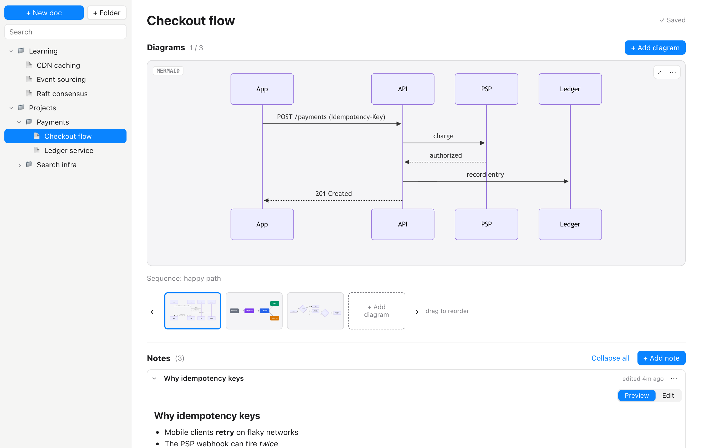

# Diagram Vault

> **Built by AI.** This app was designed and written by [Claude](https://claude.ai) (Anthropic's AI
> assistant) through Claude Design and Claude Code, directed by a human. It's a small personal tool,
> shared as-is: not reviewed or maintained as a product, and not affiliated with any employer.

A small macOS desktop app for keeping technical diagrams and the notes about them together.

<picture>
  <source media="(prefers-color-scheme: dark)" srcset="docs/screenshot-dark.png">
  
</picture>

- A sidebar library of folders and docs
- Each doc holds a set of diagrams (PNG, JPG, GIF, WebP, SVG, Mermaid) with a thumbnail strip,
  zoom/pan and a fullscreen viewer
- Markdown notes per doc, with Preview / Edit modes
- Autosaves to plain files on disk; follows the macOS light/dark setting

Built with [Wails](https://wails.io) (Go backend) and React + TypeScript.

## Where data lives

Everything is stored in `~/Documents/Diagram Vault` (override with the `DIAGRAM_VAULT_DIR`
environment variable). Folders are real folders. A doc is a folder containing `doc.json`
(title, diagram order and captions, notes as Markdown) and an `assets/` folder with the
diagram files. No data leaves your machine.

## Build and run

Requires Go, Node.js, the Xcode command-line tools and the
[Wails CLI](https://wails.io/docs/gettingstarted/installation) (v2).

```bash
cd app
wails build      # -> build/bin/Diagram Vault.app
wails dev        # live-reload development mode
go test ./...    # storage tests (run after a build, which creates frontend/dist)
```

Note: `wails dev` writes to the same `build/bin` folder and leaves a non-working app behind,
so run `wails build -clean` after a dev session.

## Layout

```
app/          Wails app (Go backend in *.go, React frontend in frontend/src)
docs/         README screenshots (sample data)
wireframes/   The Claude Design wireframe the app was built from
```

## How it was made

The app started as a set of wireframes sketched with Claude Design, comparing a few layouts
and the key states. The chosen layout ("1b", with a thumbnail strip under the viewer) was then
built by Claude Code. See [the wireframes](wireframes/wireframes.png).

## License

[MIT](LICENSE)
